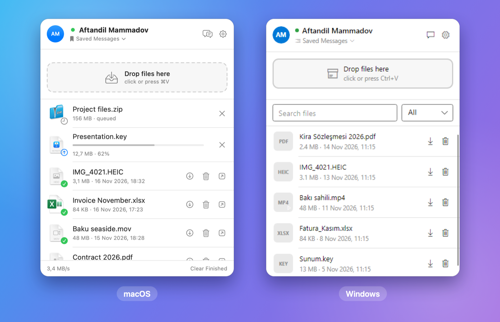

  

<h1 align="center">TeleSave</h1>

  <strong>Drop a file. It lands in Telegram.</strong> 
  Uploads anything you drag onto it to your Telegram Saved Messages — or any chat you choose.

  <a href="https://github.com/aftandilmmd/telesave/releases/latest"><strong>Download</strong></a> · macOS · Windows · Linux

  

## Features

- **Drag and drop** onto the menu bar / taskbar, paste with ⌘V / Ctrl+V, or right-click › *Send to TeleSave*.
- **Original quality** — files are sent as documents; compressed photos and albums are optional.
- **Any chat** — Saved Messages by default, or a person, group, channel or forum topic.
- **Reliable uploads** — several at once, pause when offline, resume after a restart.
- **Your files at a glance** — search, preview, download and delete the files of a chat.
- **QR login**, light and dark mode, four languages (English, Türkçe, Azərbaycan, Русский).

Your files go straight from your computer to Telegram. Nothing else is collected.

## Installing

Download the file for your system from the [latest release](https://github.com/aftandilmmd/telesave/releases/latest).

**macOS** (15 or later) — open the `.dmg` and drag TeleSave into Applications. The first time macOS blocks it: open **System Settings › Privacy & Security**, scroll to the bottom and click **Open Anyway**.

**Windows** (10 or 11) — run `…-windows-x64-setup.exe` (or `arm64` on ARM PCs). If SmartScreen appears, click **More info › Run anyway**.

**Linux** — use the `.AppImage` (`chmod +x`, then run), or install the `.deb` / `.rpm`.

Then sign in by scanning the QR code with Telegram on your phone (*Settings › Devices › Link Desktop Device*).

## FAQ

**Is this an official Telegram app?**
No. It's an independent app built on Telegram's official library (TDLib) and signs in to your own account, like Telegram Desktop.

**How big can files be?**
Up to 2 GB, or 4 GB with Telegram Premium.

---

TeleSave is not affiliated with Telegram. Telegram is a trademark of its respective owner.
